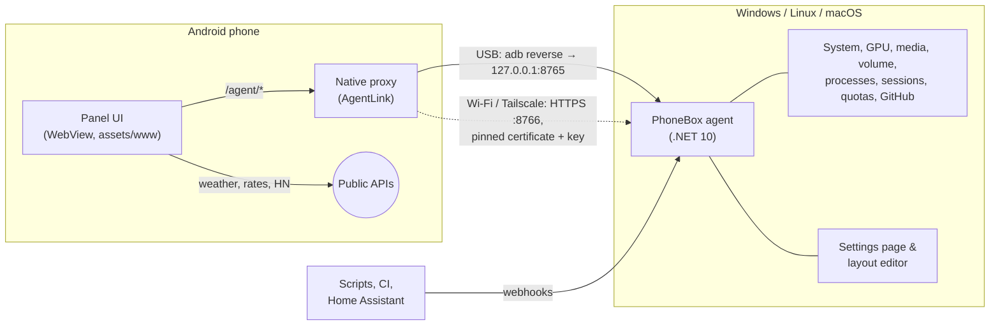

<p align="center"></p>

<h1 align="center">PhoneBox</h1>

<p align="center"><b>Turn an old Android phone into a desk panel for your computer: Windows, Linux or macOS.</b><br>
Widgets for your PC, AI coding sessions, music, weather and anything you push to it. USB or Wi-Fi, no cloud.<br>
<a href="https://ersinkoc.github.io/phonebox/"><b>▶ Try the live demo in your browser</b></a></p>

<p align="center">
  <a href="https://github.com/ersinkoc/phonebox/actions/workflows/build.yml"></a>
  <a href="https://github.com/ersinkoc/phonebox/releases/latest"></a>
  
  
  <a href="LICENSE"></a>
</p>

<p align="center"></p>

PhoneBox has two parts: a small **Android app** that runs full screen on the phone, and an **agent** on the computer
(Windows, Linux or macOS) that feeds it over the USB cable (or over Wi-Fi / Tailscale after pairing once). You design
the pages in a visual editor on the PC: **41 widgets**, **18 templates**, as many pages as you like.

- **Your PC at a glance**: CPU, GPU, RAM, disks, network and ping; the heaviest apps, with "end one instance / end all".
- **AI coding**: Claude and Codex quotas with a burn-rate forecast; every Claude Code / Codex session — the phone
  buzzes when one finishes or needs you. GitHub review requests and your pull requests with CI status.
- **Desk companion**: now playing with controls and volume, clocks, weather, sun & moon, air quality, calendar,
  pomodoro, timers, checklists, notes, a breathing exercise.
- **Stream Deck–style keys** that launch apps, URLs or built-in actions on the PC.
- **Webhooks**: scripts, CI and Home Assistant can push values and notifications onto the panel.

<p align="center"><a href="docs/phonebox-tour.mp4"></a><br>
<sub>A tour through the pages (made-up data). <a href="docs/phonebox-tour.mp4">Full video (MP4)</a></sub></p>

**Contents**: [Quick start](#quick-start) · [Pages & templates](#pages--templates) · [Widgets](#widgets) ·
[Layout editor](#layout-editor--settings) · [Webhooks](#webhooks) · [Rules](#rules) · [Wi-Fi & Tailscale](#wi-fi--tailscale) ·
[Updates](#updates) · [How it works](#how-it-works) · [Security](#security--privacy) · [FAQ](#faq--troubleshooting) ·
[Development](#development)

## Quick start

You need an Android 9+ phone with [USB debugging](https://developer.android.com/studio/debug/dev-options) turned on,
the [.NET 10 SDK](https://dotnet.microsoft.com/download) and `adb`.

**Windows 10/11**

```powershell
winget install Microsoft.DotNet.SDK.10 Google.PlatformTools   # .NET 10 and adb
git clone https://github.com/ersinkoc/phonebox
cd phonebox
.\scripts\install.ps1 -Apk -Autostart   # agent + phone app, start with Windows (add -Serial <id> if several devices are connected)
```

**Linux** (Ubuntu, Debian, Fedora, Arch…) **and macOS**

```sh
sudo apt install adb playerctl          # Fedora: android-tools playerctl · macOS: brew install android-platform-tools
git clone https://github.com/ersinkoc/phonebox
cd phonebox
./scripts/install.sh --apk --autostart  # agent + phone app; systemd user service (Linux) or launchd agent (macOS)
```

Plug the phone in: it wakes up and opens the panel. The settings are at <http://127.0.0.1:8765> (on Windows also
from the tray icon). `scripts/uninstall.ps1 [-Purge] [-Apk]` / `scripts/uninstall.sh [--purge] [--apk]` remove
everything again.

<details><summary><b>What works where</b></summary>

| | Windows | Linux | macOS |
|---|---|---|---|
| CPU, RAM, network, disks, ping | ✓ | ✓ | ✓ |
| CPU temperature | LibreHardwareMonitor | ✓ (hwmon) | — |
| NVIDIA GPU | ✓ | ✓ | — |
| Now playing + controls | ✓ (any app) | ✓ (MPRIS via `playerctl`) | Spotify, Music |
| Volume | ✓ | ✓ (`wpctl` / `pactl`) | ✓ |
| Processes, end one / all | ✓ | ✓ (your own) | ✓ (your own) |
| App icons | ✓ | ✓ (icon theme) | ✓ (app bundles) |
| Shortcuts, lock, screen off | ✓ | ✓ (`loginctl`, `xset`) | ✓ (`open`, `pmset`) |
| Command widgets | PowerShell | bash | zsh |
| Claude / Codex quotas & sessions, GitHub, webhooks | ✓ | ✓ | ✓ (Claude token from the Keychain) |
| Tray icon | ✓ | — (settings in the browser) | — |
| Start at login | Startup folder | systemd user service | launchd agent |

</details>

Optional extras that light up more widgets: an NVIDIA GPU (`nvidia-smi`), the [GitHub CLI](https://cli.github.com)
(`gh auth login`), Claude Code, Codex, and [LibreHardwareMonitor](https://github.com/LibreHardwareMonitor/LibreHardwareMonitor)
with its web server on port 8085 for the CPU temperature.

## Pages & templates

Every page is a 12 × 6 grid. Start a page from one of the 18 templates (or from scratch) and change anything.

| | |
|---|---|
| **Home** — clock, weather, now playing, CPU / GPU / RAM / network tiles | **Dashboard** — gauges, clock, media and a few shortcut keys |
|  |  |
| **AI quotas** — Claude and Codex limits, reset times, "at this pace: full in 1 d 5 h" | **Sessions** — Claude Code / Codex sessions and GitHub |
|  |  |
| **System** — CPU, GPU, memory, disks, network and ping charts | **Processes** — heaviest apps; tap one to end an instance or all of them |
|  |  |
| **Status** — quota rings, phone battery, top CPU, volume, sessions | **Ambient** — analog clock, sun & moon, air quality, quote, forecast |
|  |  |
| **Markets** — exchange rates, crypto, Hacker News | **Feeds** — values and notifications pushed by webhooks |
|  |  |
| **Daily** — checklist, time progress, timer, counter, stopwatch | **World** — world clocks, hourly forecast, calendar |
|  |  |
| **Music** — a big now-playing card | **Shortcuts** — Stream Deck–style keys |
|  |  |

More templates: **Clock**, **Focus** (pomodoro + note), **Calm** (breathing), **DevOps** (command widgets).

**Getting around.** Swipe; press the phone's **volume keys** to flip pages; tap the page dots (or long-press an empty
spot) for an overview of all pages and jump straight to one. Webhooks can switch pages too. The panel returns to
the first page when idle, dims to a clock at night and keeps the screen on.

<p align="center"></p>

## Widgets

| Category | Widgets |
|---|---|
| **Time** | Clock (with status line and weather) · Analog clock (any time zone) · World clocks · Calendar · Time progress (day / week / month / year) · Countdown · Pomodoro · Quick timer · Stopwatch |
| **Weather & sky** | Weather · Forecast (hourly / 7 days) · Sun & moon (daylight left, UV, moon phase) · Air quality (European AQI, PM2.5, PM10, O₃, NO₂) |
| **Computer** | Metric tile · Gauge · Chart · Memory & disks · Top processes · Processes · Now playing · Volume · Shortcut grid · Big button · **Command** (PowerShell output, refreshed every N seconds) |
| **AI & code** | AI quotas · Quota ring · AI sessions · GitHub |
| **Personal** | Note · Checklist (resets daily) · Counter · Breathe · Quote · Title · Phone battery |
| **Web & data** | **Pushed value** · **Notifications** (both fed by [webhooks](#webhooks)) · Hacker News · Exchange rates (ECB) · Crypto prices · Image / webcam |

Widgets scale to the size you give them. Weather, air quality, rates, crypto and Hacker News come straight from free
public APIs ([Open-Meteo](https://open-meteo.com), [Frankfurter](https://frankfurter.dev), [CoinGecko](https://www.coingecko.com),
[HN](https://github.com/HackerNews/API)) on the phone, without API keys, and keep their last data when offline.

## Layout editor & settings

Double-click the tray icon (or open <http://127.0.0.1:8765>):

<p align="center"></p>

- **Pages**: add pages from templates, reorder, show/hide; arrange widgets on a phone-sized canvas (drag to move, drag
  the corner to resize) and set their options. The widget palette is grouped by category and searchable.
  **Live preview** swaps the canvas for the real panel with your unsaved changes and live data.
- **Rules**: automations, see [Rules](#rules).
- **Shortcuts**: add, edit, reorder and test keys (label, emoji, colour, command, arguments, working folder).
- **Webhooks**: the webhook key, copy-paste examples, test buttons and the values pushed so far.
- **General**: weather location search, night mode, clock seconds, idle timeout, vibration, volume-key paging,
  the phone's sensors (brightness that follows the room, the night screen when the room goes dark, wave to wake it),
  kiosk options (screen pinning, the panel as the phone's home screen so it starts after a reboot; no root needed),
  phone selection, Wi-Fi & Tailscale, updates.
- **Advanced**: the raw JSON.

Settings live in `%APPDATA%\PhoneBox\config.json` (Linux: `~/.config/PhoneBox`, macOS: `~/Library/Application Support/PhoneBox`);
the phone picks up changes within a few seconds.

## Webhooks

The agent accepts data as well as serving it, so anything that can make an HTTP request can put things on the panel:

```sh
curl -X POST http://127.0.0.1:8765/api/push/temperature -d 21.5                     # shown by a "Pushed value" widget with key "temperature"
curl -X POST http://127.0.0.1:8765/api/push/build -H "Content-Type: application/json" \
     -d '{"value":"passed","sub":"main · 3m 12s"}'
curl -X POST "http://127.0.0.1:8765/api/push/door?ttl=600" -d open                    # expires after 10 minutes
curl -X POST http://127.0.0.1:8765/api/notify -H "Content-Type: application/json" \
     -d '{"title":"Deploy","text":"Production is live","level":"ok","page":"feeds"}' # toast + vibration (+ switch page)
curl -X POST http://127.0.0.1:8765/api/goto/music                                     # switch the phone to a page (id or number)
curl -X POST http://127.0.0.1:8765/api/refresh                                        # refresh quotas/GitHub and the panel now (?reload=1 reloads it)
```

| Payload field | Meaning |
|---|---|
| `value`, `title`, `sub`, `unit`, `icon`, `color` | What the widget shows. Plain text or a number works too. |
| `level` | `ok` / `warn` / `error` colours it; values like `passed`, `failed`, `running` are coloured automatically. |
| `progress` | 0–1 or 0–100: a bar under the value, or the ring in gauge style. |
| `items` | A list (strings or `{label, value, level}`) for the list style. |
| `ttl` | Seconds until the value disappears (also `?ttl=`). |

Notifications take `title`, `text`, `level`, `vibrate`, `seconds`, `wake` (light up the night screen) and `page`.
`GET /api/push` lists the values and `DELETE /api/push/<key>` removes one; values survive restarts.

From this PC no key is needed. With Wi-Fi on, other machines on the network or Tailscale can use
`POST` or `PUT /api/push/<key>` and `POST /api/notify` on `https://<pc>:8766` with the **webhook key**
from Settings in the `Authorization: Bearer <key>` header. Copy the example in **Settings › Webhooks**
to verify the agent's TLS public key when using curl.

## Rules

**Settings › Rules** lets the panel react to what happens on the computer. Each rule is *when → then*:

| When | Then |
|---|---|
| an AI session needs you / is working (optionally for some projects) | show a page |
| music or video plays (optionally in some apps: `Spotify\|Music`) | show a notification (`{detail}` = what happened) |
| an app is running (`zoom\|Teams\|obs64`) | push a value (e.g. `onair`, shown by a Pushed value widget) |
| the CPU stays above a percentage for 15 s | |
| you have been away from the keyboard for N minutes | |
| it is between two times (`22:00-07:00`) | |
| a pushed value is on (a webhook from Home Assistant, a doorbell…) | |

With **only while it lasts**, the effect ends with the condition: the phone goes back to the page it was on (unless
you moved on yourself) and stays on the rule's page instead of returning home when idle; a pushed value is removed
again. The editor starts from examples (Claude needs me → AI page, music → Music page, on air during calls, CPU busy,
away → Ambient, evenings → Calm, doorbell) and has a Test button for each rule.

## Wi-Fi & Tailscale

Turn on **Settings › General › Wi-Fi & Tailscale**, restart the agent when asked, and plug the phone in once. Over
USB the phone receives the PC's addresses, a secret key and the fingerprint of the agent's self-signed TLS
certificate. When the cable is unplugged it switches to `https://<pc>:8766` automatically and back to USB when it is
plugged in again; the status line shows which one it uses.

- The phone and the PC need to be on the same network. If they are not (separate Wi-Fi networks, another
  building…), install [Tailscale](https://tailscale.com) on both: the agent offers its Tailscale address too.
- Windows Firewall asks once when Wi-Fi is turned on; allow it for the network types you use.
- The screen stays on, so the phone still needs a charger — just not necessarily the PC.

## Updates

The agent checks the latest GitHub release every 6 hours (or **Settings › General › Updates › Check now**) and, with
automatic updates on, installs the new APK on the phone with `adb install -r` while it is plugged in (no prompt on the
phone; over Wi-Fi the panel shows "plug in USB to update") and replaces its own files, then restarts. Android only
accepts an update signed with the same key as the installed app; the agent never uninstalls to force one.
See the [changelog](CHANGELOG.md).

## How it works



- The WebView never talks to the PC directly: requests to `/agent/*` are intercepted by the app and forwarded over
  the adb tunnel (or the pinned HTTPS connection), so there are no CORS, mixed-content or local-network issues.
- The agent samples only what is on screen: process lists and command widgets run only while a phone looks at them.

## Security & privacy

- The agent listens on `127.0.0.1` only. Requests with a foreign `Host` header (DNS rebinding) or a cross-site
  `Origin` (CSRF) are rejected; only the settings page itself is accepted from browsers.
- The optional Wi-Fi port (8766) only serves the panel API, only over TLS pinned to the paired certificate, and only
  with the paired key. Settings, shortcut tests and pairing stay local. **New key** in the settings unpairs all phones.
- The phone only ever sends a shortcut **id**; commands are defined on the PC. Command widgets work the same way:
  the phone asks for a widget's output and never sees the command.
- Webhooks from other machines need the separate webhook key, which cannot open the phone API and can be replaced
  on its own.
- Ending processes is limited to your own session, never touches a list of Windows-critical processes, and can be
  switched off in the processes widget's options.
- **Claude quota:** read with the OAuth token Claude Code stores in `~/.claude/.credentials.json`, sent only to
  `api.anthropic.com/api/oauth/usage` (the endpoint behind Claude Code's `/usage`). The token is read-only: PhoneBox
  never refreshes it, so it can't interfere with Claude Code. This endpoint is undocumented and may change.
- **Codex quota and sessions** are read from local files in `~/.codex/sessions`; Claude Code sessions from
  `~/.claude/sessions`. Nothing leaves your machine except the requests listed above.

## FAQ & troubleshooting

<details><summary><b>The panel says "PC not connected".</b></summary>

Is the agent running (tray icon)? Run `adb devices`: the phone must be listed as `device`, not `unauthorized` —
accept the USB debugging prompt on the phone. If several devices are connected, pick the phone under
**Settings › General › Phone connection**. Over Wi-Fi, pair once over USB and allow the agent in Windows Firewall.
</details>

<details><summary><b>Some widgets show "—" or "No data".</b></summary>

GPU values need an NVIDIA GPU (`nvidia-smi`), CPU temperature needs LibreHardwareMonitor's web server on port 8085,
GitHub needs `gh auth login`, quotas and sessions need Claude Code / Codex to have been used on this PC.
</details>

<details><summary><b>I want the volume keys to change the phone's volume.</b></summary>

Turn off **Settings › General › Display › The phone's volume keys switch pages**.
</details>

<details><summary><b>The update was not installed on the phone.</b></summary>

App updates need USB (Android installs them through adb without a prompt). They also need to be signed with the same
key as the installed app — if you built the app yourself, keep using your own release key.
</details>

<details><summary><b>Can I use it without root?</b></summary>

Yes. PhoneBox needs no root on the phone and no admin rights on the PC.
</details>

## Development

```powershell
python tools/demo-server.py                  # panel + settings page with made-up data: http://127.0.0.1:8790 and /settings
.\scripts\build.ps1                          # dist\PhoneBox-<v>.apk + dist\PhoneBoxAgent-<v>-win-x64.zip
cd android; .\gradlew.bat assembleDebug      # APK only
dotnet run --project agent/PhoneBox.Agent    # agent from source
pwsh tools/make-icon.ps1                     # regenerate the .ico
```

The demo server needs only Python: size the browser window to 780 × 360 (the phone's screen in CSS pixels) and the
panel behaves as on the phone, including webhooks (`curl -X POST http://127.0.0.1:8790/api/notify -d hello`).

A widget is a `{ needs, create(box, ctx) → { update(kind) } }` entry in `W` in
[`app.js`](android/app/src/main/assets/www/app.js), plus its styles in `style.css` and its catalogue entry
(name, size, options) in [`widgets.json`](agent/PhoneBox.Agent/widgets.json), which drives the settings editor.
Templates live in [`templates.json`](agent/PhoneBox.Agent/templates.json).

Release APKs are signed with your own key when `PHONEBOX_STORE_FILE`, `PHONEBOX_STORE_PASSWORD`, `PHONEBOX_KEY_ALIAS`
and `PHONEBOX_KEY_PASSWORD` are set (in `~/.gradle/gradle.properties` or the environment); otherwise the debug key
is used. Debug builds make the WebView debuggable through `chrome://inspect`. To publish a release: bump the
version in `PhoneBox.Agent.csproj` and `android/app/build.gradle.kts`, commit, then run `.\scripts\release.ps1`.

## Extras

[`extras/umidigi-bison`](extras/umidigi-bison) has the reversible, no-root tune-up (debloat list, settings) used on
the phone PhoneBox was built for.

## License

[MIT](LICENSE)
